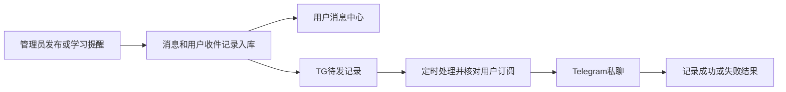

# 通知功能设计报告

日期：2026-10-27。状态：方案草案，尚未实现，不代表现有接口已经开放。

按独立开发项目设计：在现有 Vue、Hono、D1 和 Telegram 能力上增加一个通知模块。第一版提供站内消息、可选 TG 私聊推送，以及简单的学习提醒，不做通用消息平台。

## 1. 建议采用的方案

**一份消息内容，两个送达位置；学习、系统是分类，站内、TG 是渠道。**

| 维度 | 取值 | 含义 |
| --- | --- | --- |
| 消息分类 `category` | `learning`、`system` | 学习消息、系统消息 |
| 站内消息 | 始终保存 | 用户在消息中心查看，维护自己的已读状态 |
| TG 推送 | 按需发送 | 同一条消息的提醒副本，需要用户绑定并主动开启 |
| 接收对象 | 全体启用用户、指定用户 | 自动提醒直接确定对应用户，不提供复杂的人群规则编辑器 |

管理端发送时只选择“仅站内”或“站内 + TG”。即使 TG 失败，站内消息仍然存在；TG 显示发送成功也不代表用户已读。

本报告先按“用户绑定自己的 Telegram 私聊”设计。现有管理员固定接收方继续用于运维通知；不把用户学习消息发到该接收方。群、频道订阅不进入第一版。

### 首批消息

| 场景 | 分类 | 触发者 | 初期处理 |
| --- | --- | --- | --- |
| 系统维护、功能更新、使用说明 | 系统 | 管理员 | 支持站内，发布时可勾选 TG |
| 学习资料、题集更新说明 | 学习 | 管理员 | 同上，可指定用户 |
| 每日刷题提醒 | 学习 | 定时处理 | 用户主动开启，每天最多一条 |
| 考试临近提醒 | 学习 | 定时处理 | 用户主动开启，按计划对应专业的考试日期提醒 |

第一版不提供富文本、附件、审批流、模板编辑器、TG 群发营销、WebSocket 或通知规则编排。普通交卷已有即时结果页，暂不再为每次交卷制造一条通知。

## 2. 现状与可复用部分

- Neo 的通知目前只有“暂未开放”弹窗，见 [MeView.vue](../src/views/MeView.vue)。
- 当前用户通知设置接口并未开放，见 [客户端契约](client-api.md)。这里提出的接口都是新增设计。
- 后端已有 Telegram 发送、超时、错误脱敏和管理员测试能力，见 [发送实现](../../passitai-api/src/infra/telegram.ts)。可复用发送函数，不必重写一套 TG SDK。
- 现有 Telegram 设置只有一个固定 `chatId`，服务于管理员/Bot 运维通知；没有用户绑定，也没有 Webhook，见 [管理端 Telegram 契约](../../passitai-api/docs/dash-api.md#telegram-消息推送)。
- 用户的 `preferences` 已存放刷题偏好，可以增加 `notifications`，但需要同时扩展当前严格校验器，避免新增偏好导致刷题设置解析失败，见 [偏好实现](../../passitai-api/src/services/client/user-preferences.ts)。
- 刷题计划可以取得专业的 `nextExamDate`，见 [计划实现](../../passitai-api/src/services/client/practice-plan.ts)。这只是专业层面的下一次考试日期，通知不能把它描述成用户某一科的精确考试安排。
- 日常答案与未交卷进度主要保存在客户端本机。服务端交卷记录不能代表完整学习活动，见 [本地记录约定](practice-local-records.md)。因此不设计“你今天还没学习”“你连续中断三天”等判断。

## 3. 用户端

### 消息中心

在“我的”增加“消息中心”入口，显示未读数量；保留四个底部页签。

建议地址为 `/notifications`，详情为 `/notifications/:id`，两条路由复用一个页面。列表按发布时间倒序，提供“全部 / 学习 / 系统”和“只看未读”，详情可以在同页打开。TG 链接可以直接进入详情，未登录时走现有登录回跳。

消息展示标题、正文、分类、时间、已读状态，以及可选的站内操作入口。第一版正文使用纯文本和换行，不允许直接渲染 HTML。

打开详情并读取成功后标为已读；提供“全部已读”。暂不提供用户删除、置顶、收藏消息。

未读数在登录恢复、回到前台、进入消息页和标记已读后刷新。页面处于前台时最多每 60 秒刷新一次即可，切换账号清空旧消息和未读状态。首次加载失败不能用“0 条未读”冒充成功。

### 通知设置

沿用“我的 → 通知”弹窗，分成两块：

1. 学习提醒：每日提醒开关与时间、考试临近提醒开关。
2. Telegram：绑定状态、绑定/解绑、总开关、学习消息开关、系统消息开关、发送测试。

建议保存到 `users.preferences.notifications`：

```json
{
  "telegramEnabled": false,
  "telegramLearning": true,
  "telegramSystem": true,
  "studyReminderEnabled": false,
  "studyReminderTime": "20:00",
  "examReminderEnabled": false
}
```

自动学习提醒默认关闭，TG 总开关默认关闭。绑定成功仅建立关联，不自动代替用户开启推送。站内系统消息始终可以查看；关闭某类 TG 只影响该类外部推送。

第一版时间统一按北京时间 `Asia/Shanghai`。修改通知偏好只原子合并 `notifications`，不能覆盖同一 JSON 中的 `practice`。

## 4. Telegram 绑定

不让用户手填 Chat ID，也不接受前端直接指定 TG 接收方。

绑定流程：

1. 已登录用户点击“绑定 Telegram”。
2. 服务端产生 5 分钟有效的一次性随机绑定令牌，返回 `https://t.me/<bot_username>?start=<token>`。
3. 用户在自己的 TG 私聊中点击 Start。
4. Telegram 将 `/start <token>` 发到服务端 Webhook。
5. 服务端验证 Webhook 来源、令牌有效期和私聊类型，原子完成绑定并使令牌失效。
6. TG 返回固定绑定确认；用户回到应用刷新绑定状态，再选择是否开启 TG 推送。

Telegram 官方支持用 `start` 深链连接外部账号，参数最多 64 字符；使用 32 字节随机数的 base64url 字符串即可放入该限制。数据库只保存令牌摘要，不使用用户 ID 或登录 JWT 作为绑定令牌。[Telegram 深链说明](https://core.telegram.org/bots/features#deep-linking)

具体约定：一个应用账号绑定一个 TG 私聊，一个 TG 账号不能同时绑定另一个应用账号；重复回调不重复绑定。更换绑定需要用户从已登录应用明确发起，不能用新令牌直接覆盖其他人的绑定。

Webhook 使用 Telegram 的 `secret_token` 请求头验证，密钥只保存在服务端。启用 Webhook 后不再使用 `getUpdates` 轮询。[Telegram Webhook 接口](https://core.telegram.org/bots/api#setwebhook)

解绑使当前绑定版本失效，停止尚未发出的消息；已发出的网络请求和已经到达 TG 的消息无法通过解绑撤回。重新绑定不补发绑定前的历史消息。

## 5. 管理端

新增一个“消息通知”页面，管理手动消息和查看自动提醒记录。

### 发布流程

新建草稿 → 填写分类、标题、正文 → 选择接收人 → 选择是否附加 TG → 预览 → 发布。

标题建议最多 80 字，正文最多 2,000 字。接收人只有“全体当前启用用户”和“指定用户”，指定用户复用已有用户搜索；第一版不增加可视化人群筛选器。

预览显示预计接收人数、符合条件的 TG 人数，以及 TG 文本效果。实际接收人以首次发布事务中的结果为准；发布后的新注册用户不自动收到历史广播。

草稿允许编辑和删除；发布后正文、分类与接收对象固定，误发时另发更正，不直接改掉用户已看到的内容。首版不承诺撤回已送到 TG 的消息。

### 发布结果

详情展示：站内接收人数、已读人数、TG 待发送/成功/跳过/失败/结果未确认数量。可以查看具体用户的投递结果，已成功的行不提供重复发送。

发送失败可在修正原因后重试。结果未确认必须明确提示“可能已经收到，重发可能重复”，不能当成普通失败自动重试。学习/系统订阅、用户解绑和停用状态均不能被管理员重试操作绕过。

### Telegram 配置

沿用现有 Telegram 设置页与 Bot Token，区分“管理员运维通知”和“用户通知”两个开关。原来的固定 Chat ID 只属于管理员运维通知。

用户通知额外需要：已核实的 Bot 用户名/身份、用户端主域名、Webhook 状态。Bot 用户名和 ID 通过服务端 `getMe` 核实，不靠手填；主域名用于拼接消息详情链接，不能取用户请求中的任意 Origin。

Webhook 地址由当前部署的固定 API 域名生成，管理端操作只提交空正文，不接受任意外部回调 URL。Webhook 密钥由服务端生成，不向管理端或用户端回显。

同一个 Bot Token 的轮换可以继续使用已有绑定；如果实际更换成另一个 Bot，则旧绑定需要重新建立，不能把旧 Chat ID 当作新 Bot 已获授权的接收方。

## 6. 服务端数据

新增三张表，通知偏好继续放现有用户表。

### `notifications`：消息内容

| 字段 | 用途 |
| --- | --- |
| `id` | 通知 ID，建议 `ntf` 前缀，沿用现有实体 ID 规则 |
| `category` | `learning` / `system` |
| `title`、`content` | 标题与纯文本正文 |
| `linkPath` | 可选站内相对路径；不接收外部 URL |
| `source`、`eventKey` | 手动/每日提醒/考试提醒；自动事件去重键，手动为空 |
| `audience`、`userIds` | 全体或指定用户；指定 ID 按项目现有 JSON 约定保存 |
| `telegram` | 是否申请附加 TG |
| `status` | `draft` / `published` |
| `createdBy`、`createdAt`、`publishedAt` | 发布主体与时间；自动消息没有管理员创建者 |
| `telegramExpiresAt` | 可选 TG 投递截止时间，过时提醒不再补推 |

`eventKey` 建唯一索引。发布后不可编辑消息内容与目标，防止站内内容和已发送 TG 不一致。

### `user_notifications`：每位用户的收件记录

以 `(notificationId, userId)` 为唯一键，保存 `readAt`。

同一行保存少量 TG 投递字段：`telegramStatus`、绑定版本快照、尝试次数、下一次尝试时间、处理租约、成功的 `messageId`、发送时间及脱敏错误。无需再拆一套多渠道投递表。

| TG 状态 | 含义 |
| --- | --- |
| 空 | 这条消息仅站内展示 |
| `pending` | 等待处理，包括已排定的限流重试 |
| `sent` | Telegram 返回明确成功，并记录 messageId |
| `skipped` | 未绑定、关闭订阅、账号停用、绑定变化或已过投递期限 |
| `failed` | 明确失败，需要修正原因或人工处理 |
| `unknown` | 发送结果不确定，不能安全假定“没发送” |

建议索引：`(userId, notificationId)`、未读查询相关索引，以及 `(telegramStatus, nextAttemptAt)`。列表通过消息表的 `publishedAt, id` 稳定倒序，不为未读数另维护一份容易漂移的计数。

### `user_telegram`：用户绑定

每个用户一行，保存 `telegramUserId`、`chatId`、`botId`、可选用户名、绑定时间、绑定版本、暂停时间，以及待绑定令牌摘要与有效期。TG ID 使用字符串保存。

待绑定时允许接收方字段为空；令牌在同一行更新，原子消费，因此不需要第四张绑定令牌表。对 TG 身份建立唯一约束；解绑或重绑递增绑定版本，使旧待发任务失效。

## 7. 发送与定时处理



### 站内发布

发布只做数据库操作，不在管理员请求中循环发送 TG。

手动发布在 D1 原子批次中完成：仅在草稿状态下，通过 `INSERT ... SELECT` 生成当时符合条件的用户收件记录，再将消息改为已发布。利用唯一键保证重复点击、超时后重试同一个发布 ID 不会产生第二份收件记录。

首版直接按当前用户量落库，不先建设广播任务平台。发布事务出现错误时全部回滚，不能对外声称已经发布。受众数量增长到该事务不能稳定完成时，再单独改成分批分发。

### TG 投递

增加一个每分钟执行的 Cron 入口，扫描已持久化的待发记录。处理每条消息时：

1. 原子认领该行，使用短租约防止重复处理。
2. 再次核对用户启用状态、订阅开关、当前 Bot 和绑定版本、提醒期限。
3. 通过现有 TG 发送基础函数发送，接收方只来自服务端绑定。
4. 按租约标识登记结果，旧处理不能覆盖新一轮结果。

初始每轮最多处理 10 条、串行发送并控制间隔，达到本轮时间预算便留到下一轮。小规模项目接受约一分钟级的排队延迟，不承诺秒级送达。遇到积压先在管理端显示待发数量和最老待发时间，再决定是否扩容。

不只依靠 HTTP 请求结束后的 `waitUntil` 来保证送达：该机制在 HTTP 响应结束后有 30 秒延长限制，待发记录必须先入库，后续定时执行才能继续处理。[Cloudflare waitUntil 说明](https://developers.cloudflare.com/workers/runtime-apis/context/)

### 失败处理

- Telegram 明确返回 `429`：按 `retry_after` 排下次处理时间；有限次数后停止，不能立刻循环重试。[Telegram 限流参数](https://core.telegram.org/bots/api#responseparameters)
- 明确的无权限、用户屏蔽或无效接收方：记失败并暂停该绑定的后续发送，等待用户恢复，不持续刷请求。
- Token 或全局配置异常：暂停本轮用户推送，管理端显示配置问题，保留尚未处理的任务。
- 网络超时、响应丢失、进程在发送期间退出：记 `unknown`，租约过期也不盲目补发。实际消息可能已经到达 TG。
- `sent` 不再重发；人工处理也不能承诺 TG 严格只收到一次。通知入库的幂等与第三方实际投递是两个不同问题。

当前 TG 基础层将部分接收方错误统一映射为 502；实现时需要在内部保留可判别的上游失败信息，供暂停/重试判断。对外继续使用现有 HTTP 状态和统一 envelope，不新增业务错误码字典，也不输出含 Bot Token 的 URL。

## 8. 学习提醒规则

### 每日提醒

仅为主动开启且存在有效刷题计划的用户生成，默认提醒时间建议 20:00。文案例如：“今天也安排一点刷题时间吧，继续你的学习计划。”

不判断用户今天是否学习，不虚构答题数量、正确率或学习时长。去重键为 `study:<userId>:<北京时间日期>`，同一用户每天最多一条；扫描补偿窗口建议 15 分钟，服务长时间恢复后不追发多天旧提醒。设置变化不重新补发当天已生成的消息。

### 考试临近提醒

读取当前有效计划对应专业的 `nextExamDate`。建议在提前 7 天和 1 天的北京时间 09:00 各提醒一次；日期为空、格式错误、已过期或计划失效时不发送。

文案明确“你当前专业标注的考试日期”，并提示以官方安排为准。去重键包含用户、专业、考试日期和提前天数；专业考试日期改变后重新计算，避免沿用旧日期。

两种提醒均默认关闭，TG 是否发送还要再经过 TG 总开关与学习分类开关。每日提醒的 TG 截止时间为当日结束；考试提醒超过当天有效窗口后跳过，站内已产生的消息保留时间上下文。

Cron 配置使用 UTC，业务日期和用户输入的时间按 `Asia/Shanghai` 转换；不能直接拿 Worker 运行环境的本地时间判断“今天”。[Cloudflare Cron 时间说明](https://developers.cloudflare.com/workers/configuration/cron-triggers/)

## 9. 接口草案

沿用 `{ ok, data, message? }`、现有 HTTP 状态和 `page=1&limit=20` 分页约定，`limit` 最大 100。下列接口尚不存在。

### 用户端：app scope

| 方法 | 路径 | 用途 |
| --- | --- | --- |
| GET | `/api/notifications` | 列表，支持 category、unread、page、limit |
| GET | `/api/notifications/unread-count` | 未读总数 |
| GET | `/api/notifications/:id` | 当前用户收到的消息详情 |
| PUT | `/api/notifications/read-all` | 将请求开始时已收到的消息标为已读 |
| PUT | `/api/notifications/:id/read` | 幂等标记一条已读 |
| GET / PATCH | `/api/user/settings/notifications` | 读取和部分修改通知偏好 |
| GET | `/api/user/telegram` | 用户绑定状态、可用性、Bot 用户名 |
| POST | `/api/user/telegram/bind-link` | 生成短期绑定链接 |
| DELETE | `/api/user/telegram` | 解绑并使待发绑定版本失效 |
| POST | `/api/user/telegram/test` | 向自己的当前绑定发送固定测试消息，正文 `{}` |

列表 data 建议为 `{ items, total, unreadCount }`。每项包含 `id, category, title, contentPreview, publishedAt, readAt`；详情另含完整 `content` 和 `linkPath`。用户响应不暴露其他收件人或内部投递错误。

用户身份始终来自 JWT，不接受客户端提交 `userId` 或 `chatId`。其他用户的消息和不存在的消息统一返回 404。详情 GET 不隐式标记已读；read-all 先固定服务端截止时间，再更新截止时间之前的收件记录，避免顺带读取之后才到达的新消息。

个人 TG 测试要求用户通知服务可用、绑定有效且用户 TG 总开关已开启，只发送固定文本；不能通过测试接口绕过全局停用或指定其他接收方。

### 管理端：admin scope

| 方法 | 路径 | 用途 |
| --- | --- | --- |
| GET / POST | `/api/dash/notifications` | 查询通知 / 新建草稿 |
| GET / PUT / DELETE | `/api/dash/notifications/:id` | 详情 / 编辑草稿 / 删除草稿 |
| POST | `/api/dash/notifications/:id/publish` | 幂等发布 |
| GET | `/api/dash/notifications/:id/recipients` | 接收人与已读、TG 投递结果 |
| POST | `/api/dash/notifications/:id/retry-telegram` | 重试符合条件的指定失败行 |

新建草稿正文示例：

```json
{
  "category": "system",
  "title": "系统维护通知",
  "content": "今晚将进行短时维护，请提前保存作答。",
  "audience": "all",
  "telegram": true
}
```

指定用户时使用 `audience: "users"` 和去重后的 `userIds`。第一版限定指定用户列表最多 100 人，全体发送使用数据库筛选，避免传输海量用户 ID。

发布接口返回消息 ID、发布时间和实际接收人数，表示“站内已发布、TG 已排队”，不能直接返回“全部发送成功”。对已发布消息编辑或删除返回 409。

现有 `GET/PUT /api/dash/settings/telegram` 扩展用户通知所需设置；新增 `GET/POST /api/dash/settings/telegram/webhook` 查询状态或注册固定 Webhook。原有管理员固定测试接口继续按原用途工作。

### Telegram 回调

`POST /api/telegram/webhook` 不使用用户 JWT，只接受正确的 Telegram Webhook 密钥和严格校验后的消息。只处理私聊绑定及固定帮助指令，不变成任意聊天机器人或业务执行入口。

重复绑定回调安全返回成功；不相关更新直接确认忽略；数据库暂时失败时返回失败，让 Telegram 重试。不要因发送一条绑定确认文本失败就回滚已经完成的账号绑定。

## 10. 代码落点

命名统一使用 `notifications`，按现有目录放置，不建立独立微服务或消息框架。

| 项目 | 主要落点 |
| --- | --- |
| API | `routes/client/notifications.ts`、`services/client/notification.ts`：用户收件箱与学习提醒生成；用户绑定接口挂现有 user 路由 |
| API | `routes/dash/notifications.ts`、`services/dash/notification.ts`：草稿、发布与投递查看 |
| API | `infra/notification.ts`：共用入库、待发处理；`infra/telegram.ts`：现有发送；定时入口直接调用共用处理 |
| API | `db/schema/notifications.ts` 集中三张小表，`schemas/notification.ts` 放输入校验，按现有规则补数据库定义 |
| Neo | `views/notifications/NotificationsView.vue`、`api/notifications.ts`；“我的”复用通知设置弹窗 |
| Dash | `views/notifications/NotificationListView.vue`、`api/notifications.ts`；编辑与结果面板先放同一业务目录 |

Client、Dash Service 各自处理权限与页面语义，共用通知基础能力不能反向依赖这些 Service。无需为了通知增加通用 Repository、渠道注册器或插件系统。

定时入口先调用 Client 侧学习业务生成到期提醒，再调用共用 TG 待发处理。偏好结构由 schema 校验，不能让 infra 为读取偏好而反向调用 Client Service。

消息列表留在页面；未读数可用一个小 composable 在同账号页面间共享，账号切换时清空。只有确实出现多页面共享复杂状态时才增加 Store。

新增通知与 TG 绑定路由必须同时加入实际鉴权挂载：当前 Client 使用受保护前缀白名单，单纯新增路由文件不等于已经接入 appAuth。Webhook 是单独的密钥校验入口。

现有 API 与数据表规则仍需遵守。本报告不执行数据库重建、不注册真实 Webhook、不发送测试消息，也不提前改动“已开放接口”契约。

## 11. 实施顺序和验收

| 阶段 | 交付 | 验收重点 |
| --- | --- | --- |
| 1 | 站内消息、管理员发布、用户消息中心 | 接收人权限、发布幂等、已读独立、换账号隔离 |
| 2 | 用户 TG 绑定、设置和持久化投递 | 令牌一次性、私聊校验、真实目标、限流、失败与未知结果 |
| 3 | 每日提醒、考试提醒 | 北京时间、有效计划、重复扫描去重、过时不补发 |

关键回归：两个用户不能读取或标记彼此消息；同一通知重复发布不重复收件；发布后的新用户不收到旧广播；关闭订阅或解绑后不继续发送待发消息；TG 故障不影响站内阅读；超时不伪造成功；定时任务重复执行不生成第二条提醒；保存通知偏好不影响刷题设置；切换账号后旧请求不改写新账号界面。

本文默认采用用户 TG 私聊、自动提醒默认关闭、考试提前 7 天和 1 天提醒。这三项可以在评审时调整，站内消息模块可以先独立落地。
